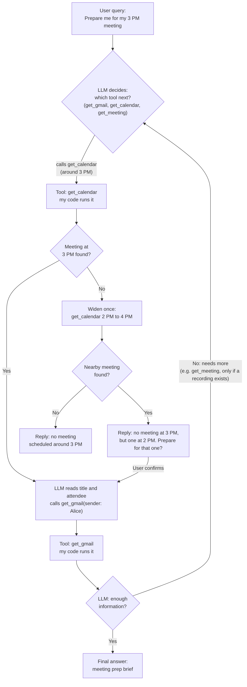

# Personal AI Executive Assistant: Design

## Steps

| # | Step | Type | Input | Output |
|---|------|------|-------|--------|
| 1 | Fetch emails | Tool (Gmail API) | Previous day's emails | Raw emails |
| 2 | Summarize emails | LLM | All of the previous day's emails | Email summary |
| 3 | Fetch calendar | Tool (Calendar API) | Today's calendar | Today's events |
| 4 | Build schedule | LLM | Today's events | Today's schedule |
| 5 | Transcribe meeting | Tool (Whisper) | Meeting recording | Transcript |
| 6 | Summarize meeting | LLM | Transcript | Meeting summary |
| 7 | Write briefing | LLM | All of the above | Morning briefing with priorities |

## Autonomy

Today the assistant is a fixed workflow.
- All steps and tool calls are predefined in my code.
- The LLM only does the tasks assigned to it (summarizing and writing).

Planned agent version (LangGraph):
- The input becomes a request in plain language, such as "Prepare me for my 3 PM meeting".
- The model chooses which tools to call and in what order, and decides when it has enough information.
- Examples of decisions it would make: search emails from a person who appears in a meeting, check the calendar when an email mentions a deadline, skip transcription when there is no audio file.
- A checker step compares the briefing with the source data and fixes anything missing.
- The agent asks before any action with side effects, such as drafting a reply.

## Tools 

These tool definitions describe the planned agent version. Anything marked planned is not built yet.
### 1. `get_gmail`
- **Description:** Reads emails from the user's authenticated Gmail account and returns their sender, subject, date and text. Use it for a summary of emails on a day or date range, and for finding specific emails by sender, subject or keyword. This tools only read emails. When no filters are given, the tool returns the newest emails, up to max_results. Results come back newest first, so "mails from Alice" gives her latest emails.
- **When to use:** The user asks about emails, for example "what came in yesterday" or "find the email from Alice about the interview".
- **When not to use:** Calendar or free-time questions (use `get_calendar`), questions about a recorded meeting (use `get_meeting`), and anything that sends, replies to or deletes email.
- **Inputs:**
  - `after` (date `YYYY-MM-DD`, optional): only emails received on or after this date.
  - `before` (date `YYYY-MM-DD`, optional): only emails received before this date.
  - `sender` (string, optional): sender name or address, for example `"alice@example.com"`.
  - `query` (string, optional): keywords to search for in the subject or body, for example `"interview"`. Do not put sender filters here; use `sender`.
  - `max_results` (integer, default `20`): the most emails to return.
  - `include_promotions` (boolean, default `false`): when `false`, Promotions and Social emails are left out.
  - For a summary of a day, pass only `after` and `before`.
- **Output:**
  - `total_found`: how many emails matched in total, so the agent knows if the list was cut off.
  - `emails`: a list where each item has `message_id`, `thread_id`, `sender`, `subject`, `received_at` and `body` (plain text, shortened to about 1,000 characters).
  - If nothing matches, it returns `total_found: 0` and an empty list.

### 2. `get_calendar`
- **Description:** Reads events from the user's authenticated Google Calendar and returns each event's title, start time, end time and attendees. Use it for a summary of events on a day or date range, and for finding events by a keyword in the title or description. This tool only reads the calendar. With no filters, it returns upcoming events starting from now, ordered by start time, so "what is my schedule" gives the nearest events first, not events days away.
- **When to use:** The user asks about their calendar. For example, "what is my next schedule", or "Am I free at 3 PM?" (no events around 3 PM means free, any event means busy).
- **When not to use:** Email questions (use `get_gmail`), questions about a recorded meeting (use `get_meeting`), and creating, changing or deleting events.
- **Inputs:**
  - `start` (date-time `YYYY-MM-DDTHH:mm±HH:mm`, optional): only events that start on or after this time. For example, `2026-11-25T14:00+05:30` is 25 Nov 2026, 2 PM India time.
  - `end` (date-time `YYYY-MM-DDTHH:mm±HH:mm`, optional): only events that start before this time.
  - `query` (string, optional): keywords to search for in the event `title` and `description`.
  - `max_results` (integer, default `20`): the most events to return.
  - For a full day, pass `start` at 00:00 and `end` at 23:59 of that day.
- **Output:**
  - `total_found`: how many events matched in total, so the agent knows if the list was cut off.
  - `events`: a list where each item has `event_id`, `title`, `start`, `end` and `attendees`.
  - If nothing matches, it returns `total_found: 0` and an empty list.

### 3. `get_meeting`

- **Description:** Transcribes one recorded meeting audio file from the user's computer and returns the text of what was said. Use it when the user asks what was discussed, decided or assigned in a recorded meeting. It handles one recording at a time and does not summarize; the agent writes the summary from the transcript. To cover several meetings, call it once for each recording.
- **When to use:** The user asks about what was said, decided or assigned in a recorded meeting. For example, "What tasks were assigned to me?" or "What did Alice discuss in the meeting?"
- **When not to use:** Upcoming or past meeting times (use `get_calendar`), emails (use `get_gmail`), and live meetings, since the tool works on recorded files only.
- **Inputs:**
  - `file_name` (string, optional): the recording to transcribe, for example `"meeting_audio.mp3"`. If not given, the most recent recording is used.
- **Output:**
  - `file_name`: the recording that was transcribed.
  - `text`: the transcript of what was said, shortened to the first 50,000 characters if it is very long.
  - If no recording is found or the file cannot be read, it returns an error message such as "No recording found" and no text.
- **Planned:** an optional `meeting_start` input, so the agent can pick the recording that matches a calendar event. This needs recordings to be saved with their date and time.
- Also handle longer meetings by splitting the transcript into parts.

## Agent flow

## Decision rules

- **No meeting at the requested time:** If the calendar has no event at the requested time, the agent checks once from one hour before to one hour after. If it finds a nearby meeting, it tells the user, for example: "There is no meeting at 3 PM, but there is one at 2 PM, 'Project review', with Alice. Do you want me to prepare for that one?" If it finds nothing, it replies: "There is no meeting scheduled around 3 PM." The agent does not search any wider.

## Evals

Component-level checks test one step. End-to-end checks test the final briefing.

### End-to-end

| # | Question | How I check it |
|---|----------|----------------|
| 1 | Does the briefing include every meeting on today's calendar? | Code: compare event titles from the Calendar API with the briefing text |
| 2 | Are spam and promotional emails left out of the email summary? | Code: check the Gmail category label on each email used |
| 3 | Is the briefing clear and correctly prioritized? | LLM as a judge: score from 1 to 5 |

### Component-level

| # | Question | How I check it |
|---|----------|----------------|
| 4 | Does the transcript capture names correctly? | Code: record a short sample with known names, then count how many appear in the transcript |
| 5 | Does each email summary keep the sender and any deadline? | LLM as a judge on a small set of sample emails |

### Test data

I keep a small fixed set of sample emails, calendar events and one audio file, so I can re-run the same checks after every change and compare results between the workflow and the agent.

## Honest scope

### What it does today
- Reads the previous day's emails from Gmail and today's events from Google Calendar.
- Transcribes a local meeting audio file with Whisper (through Groq).
- Uses an LLM to summarize the emails and the meeting, then combines everything into one morning briefing with priorities.
- Runs when I start it. It does not run on its own.

### What it does not do yet
- It is a fixed workflow, not an agent. The order of steps and the tools are decided in my code.
- It does not send emails, reply, or create calendar events.
- It works on a recorded audio file only. It does not join live meetings.
- It has no formal evaluation results yet.

### Planned
Convert it to a LangGraph agent, run the same evals on both versions, and update this file with the results.
